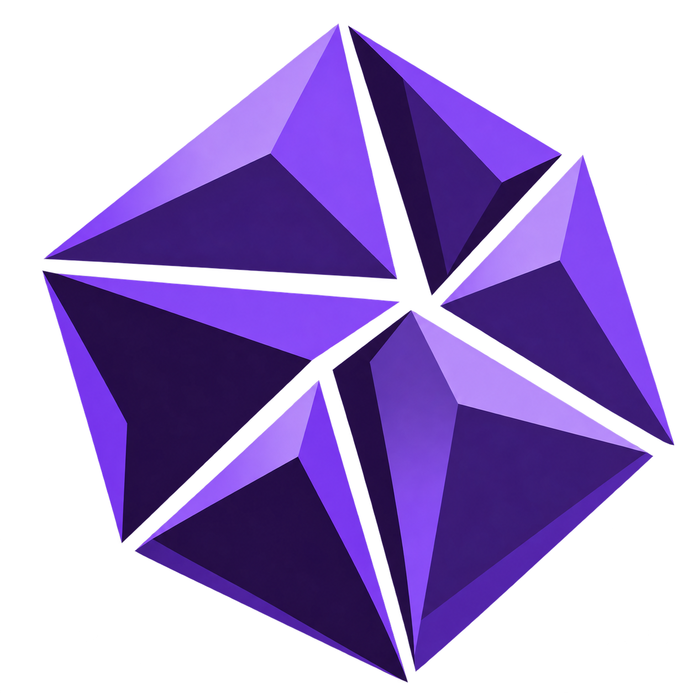

<p align="center">
  
</p>

<h1 align="center">Ferber</h1>
<p align="center">
  <sub>Ferber was previously called Wolfram.</sub>
</p>

<p align="center">
  <em>A capability-based microkernel. Zero ambient authority. Programs earn every resource they touch.</em>
</p>

<p align="center">
  <a href="https://github.com/ferber-os/ferber/actions/workflows/ci.yml"></a>
  <a href="https://github.com/ferber-os/ferber/releases"></a>
  <a href="https://github.com/ferber-os/ferber/stargazers"></a>
  <a href="https://github.com/ferber-os/ferber/network/members"></a>
  <a href="https://github.com/ferber-os/ferber/issues"></a>
  <a href="https://github.com/ferber-os/ferber/pulls"></a>
  <a href="LICENSE"></a>
</p>

<br>

Ferber is a microkernel operating system written in Rust. It boots in QEMU on
RISC-V 64 and x86-64, and has passed resident userspace checks on physical
x86-64 hardware.
It is not a Linux distribution. It is not a fork. It is a kernel built from first principles around
one idea: **programs should not have access to anything they weren't explicitly given.**

There is no root. There is no `sudo`. There is no ambient authority.
Every resource is a capability handle. Every handle has explicit rights.
Every transfer is intentional. Every revocation is instant.

This is not a weekend project. It is not finished. It may never be finished.
But the architecture is right, and that matters more than being finished.

---

## The Model

In most operating systems, security is a layer on top of the kernel.
Permission bits, UIDs, ACLs, SELinux policies. All of these are answers to the question
"should this process be allowed to do this?" asked after the process already named the resource.

Ferber asks a different question: **how did this process get a reference to that resource at all?**

If it doesn't have a handle, it can't name it. If it can't name it, the question never arises.
Capability possession *is* the permission. There is no separate check.

This is called capability-based security. It is not a new idea.
Ferber is a new implementation of it, in Rust, for modern hardware,
with zero legacy constraints and zero tolerance for ambient authority.

---

## Architecture

```
Ferber Kernel (microkernel)
├── Capability enforcement     — the core. handle tables, rights, attenuation, revocation.
├── Scheduler                  — jobs → processes → threads. no fork. no ambient inheritance.
├── IPC                        — async channels + FastCall. handle transfer is move semantics.
├── Memory                     — VMO-everything. no anonymous memory. hardware-enforced rights.
└── HAL                        — architecture abstraction. RISC-V and x86-64 first.

Ferrum (userspace foundation)
├── libc port                  — musl-based, Ferber syscall ABI
├── VFS server                 — filesystem abstraction as a capability service
├── Driver framework           — userspace drivers, MMIO via Physical VMO
└── Init                       — job tree root. everything descends from here.

fer (unified system CLI)
├── fer pkg                    — package management
├── fer drv                    — driver management
├── fer cap                    — capability inspection and revocation
├── fer jobs                   — job tree visualization
├── fer mem                    — memory and VMO inspection
└── fer ipc                    — IPC channel monitoring
```

---

## Capability Model

Every kernel object — process, thread, VMO, channel, device — has handles.
Handles are unforgeable. You cannot guess one. You cannot forge one.
The kernel is the only entity that creates them.

Every handle carries a rights bitmask:

```
DUPLICATE   TRANSFER   READ   WRITE   EXECUTE
MAP         SIGNAL     WAIT   INSPECT MANAGE
```

When you pass a handle to another process, you can only pass equal or fewer rights.
Authority flows downward. It can never be amplified.
A child cannot have more access than its parent granted.
A parent cannot grant more than it holds.

Revocation is instant. Capability nodes are invalidated at the kernel level.
Every handle pointing through a revoked node loses access immediately.

In Rust, this enforced at compile time too:

```rust
// these are different types — you cannot mix them up
Handle<Vmo, Read>
Handle<Vmo, ReadWrite>
Handle<Channel, ReadWrite>

// this is a compile error, not a runtime error
fn write(h: Handle<Vmo, ReadWrite>, data: &[u8]) { ... }
write(read_only_handle, data) // ← compiler rejects this
```

Two layers of enforcement. The compiler catches the obvious mistakes.
The kernel catches everything else.

---

## What Ferber Is Not

- Not a Linux distribution
- Not a Linux replacement (yet)
- Not API-compatible with POSIX (by design)
- Not finished
- Not safe to run in production
- Not something you should daily drive today

---

## What Ferber Will Be

- A kernel you can understand completely
- A security model that isn't bolted on
- A system where `fer cap audit <pid>` tells you everything
- Something worth daily driving
- A community project with a real identity

---

## Versioning

Ferber uses element names for releases.

| Tier | Elements | Meaning |
|---|---|---|
| Nightly | Uranium, Thorium, Plutonium | Radioactive. Unstable by definition. |
| Unstable | Lithium, Sodium, Potassium | Reactive. Handle with care. |
| RC | Fluorine, Chlorine, Bromine | Getting closer. Still sharp edges. |
| Stable | Helium, Neon, Argon, Krypton, Xenon | Inert. Doesn't react. Ships. |

First release: **Uranium-238-v0.1.0** (nightly). Phase 1 has reached its first
hardware milestone on the MSI B650M-A PRO WIFI; the release tag identifies
that milestone, not a feature-complete or security-complete system.
Current milestone: **Uranium-238-v0.2.14** enforces hierarchical Job memory
budgets on both ports. Heap pages, owned VMO backing and private page tables
retain their allocation owner through capability transfer and creator teardown.
Limits include allocator overhead and descendant allocations; closed Jobs cannot
allocate new storage. See [Job accounting](docs/job-accounting.md) for ownership
and concurrency boundaries. The release ISO continues to boot minimal Ferrum
init. Userspace task creation and service launch remain pending.
Phase 2 concluded with `v0.1.7`.

---

## Roadmap
See [ROADMAP.md](ROADMAP.md).

---

## Building

Install Rust nightly and the targets you need:

```bash
rustup toolchain install nightly
rustup target add riscv64gc-unknown-none-elf riscv64imac-unknown-none-elf x86_64-unknown-none x86_64-unknown-uefi --toolchain nightly
export RUSTUP_TOOLCHAIN=nightly
```

Install QEMU to run the kernel. ISO builds also require xorriso, dosfstools, and mtools.

```bash
make build                         # RISC-V kernel
make run                           # boot in QEMU
make debug                         # boot with GDB on :1234
make run USERSPACE_ELF_PROBE=1      # boot the external userspace ELF
make run MINIMAL_INIT=1             # boot minimal Ferrum init
make x86-preview                   # build and check the x86 kernel
make x86-iso                       # build a bootable x86 ISO
make x86-iso USERSPACE_ELF_PROBE=1 # deliver the external userspace ELF
make x86-iso MINIMAL_INIT=1        # package minimal Ferrum init
```
---

## Contributing

Read [CONTRIBUTING.md](CONTRIBUTING.md) for the project’s contribution standards. If your work changes kernel architecture, read [docs/architecture.md](docs/architecture.md) and [docs/capability-model.md](docs/capability-model.md) before proposing a design.

### Not sure where to start?

Your first contribution does not need to touch the kernel.

- **New to systems programming:** documentation, tests, CI and tooling, or diagnostics.
- **Comfortable with Rust:** bounded kernel tasks, syscall plumbing, validation, and tests.
- **Comfortable with low-level systems or architecture code:** paging, syscall paths, scheduler, drivers, and RISC-V/x86-64 parity.
- **Security-focused:** capability-model review, unsafe invariants, threat modeling, or fuzzing.
- **Non-code:** translations, documentation, testing, UX, or Easter eggs and voice text where appropriate.

The roadmap describes project direction. Not every unchecked item is a good first issue. Prefer issues labeled `good first issue`, `help wanted`, or an equivalent contributor-friendly label. If you do not see a scoped issue, ask before taking on a large change.

The kernel is written in Rust. The docs are written in English.
Both should be precise, honest, and free of unnecessary complexity.

If you find a security issue in the capability model specifically, that's important. 
Open an issue marked `[SECURITY]` and be detailed.

Non-code contributions are also welcome. 
<br>

## Special thanks to our contributors:

<p align="center">
  <a href="https://github.com/ferber-os/ferber/graphs/contributors">
    
  </a>
</p>

---

## License

GPL v2. Same as Linux. Derivatives stay open.
